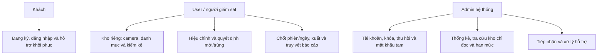
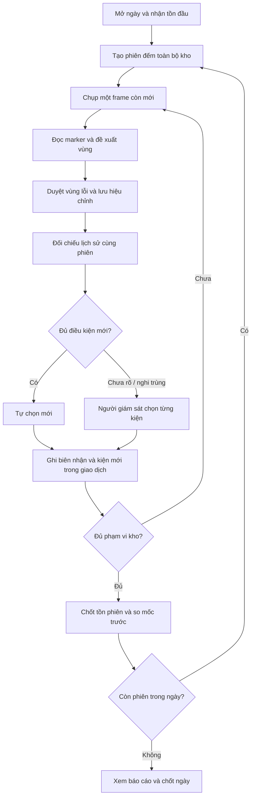
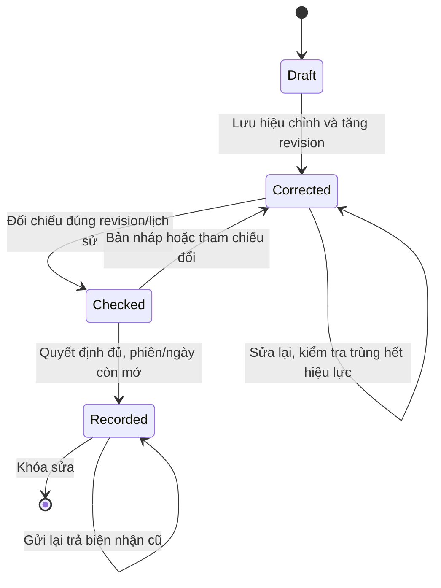
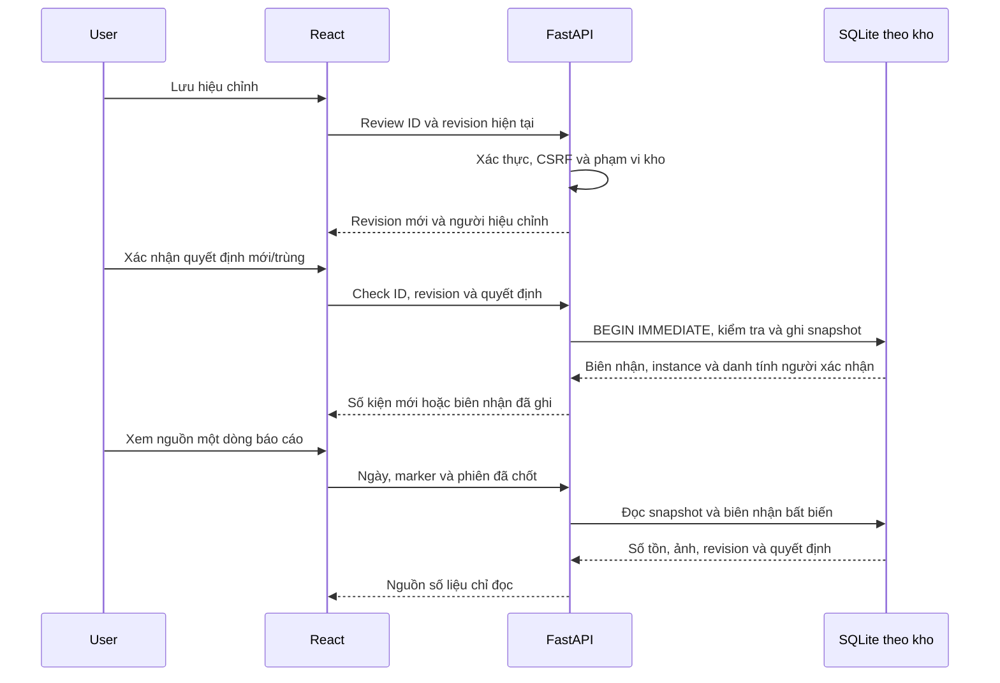
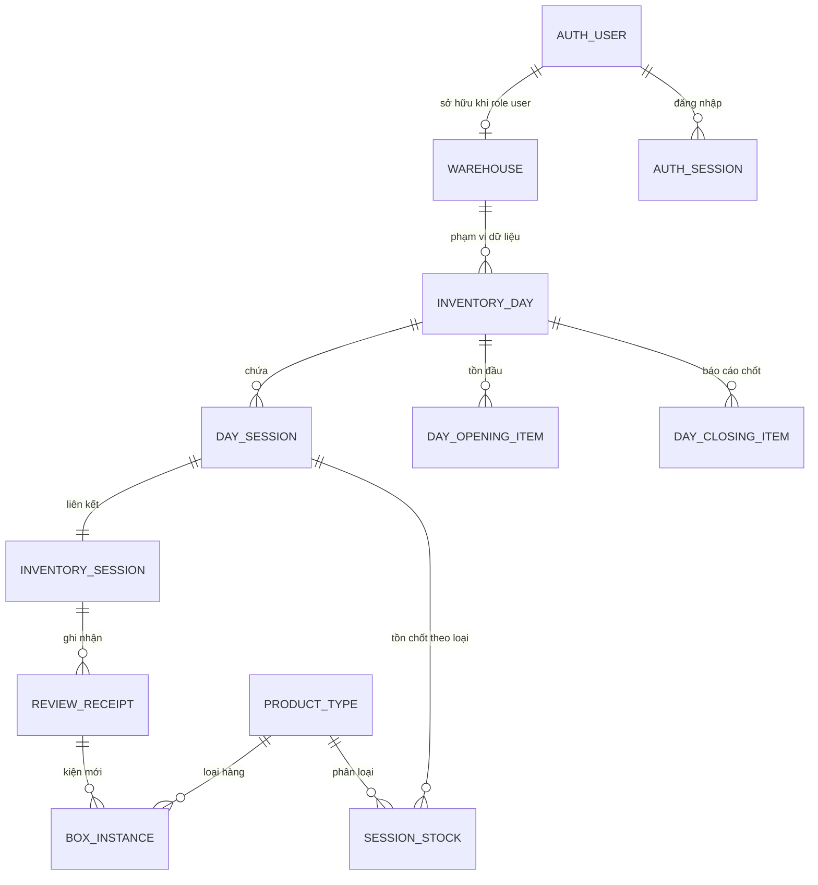
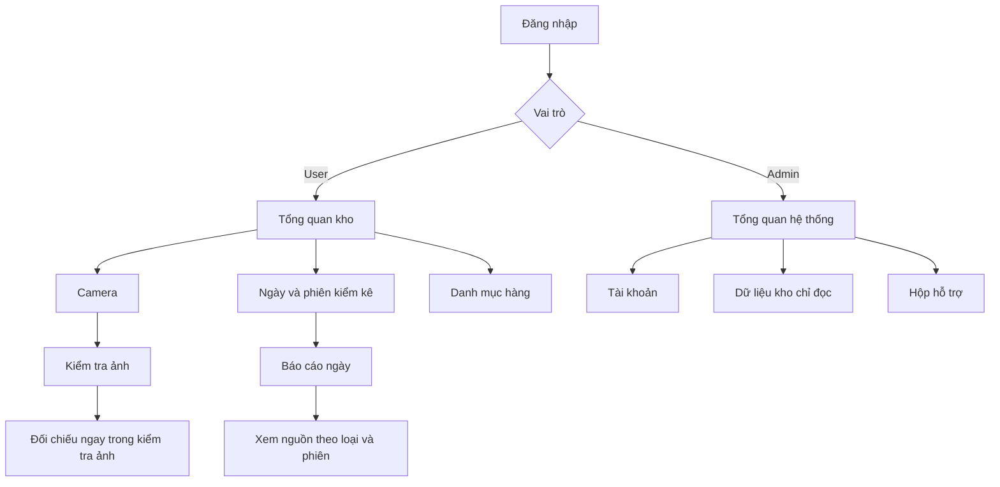

# Thiết kế hệ thống local

Đối chiếu mã tại nhánh hoàn thiện local ngày 29/10/2026 và hồ sơ yêu cầu phiên bản 2.
Các sơ đồ mô tả chức năng hiện có và phần truy vết trong bản này. Không coi GitHub
Public là triển khai ứng dụng HTTPS; phần truyền camera Internet vẫn tạm dừng.

## Ca sử dụng và quyền

Admin không trực tiếp kiểm kê bằng vai trò admin. Khôi phục không hiển thị mật khẩu
cũ. Mỗi API nghiệp vụ chạy trong phạm vi kho được xác thực, không tin warehouse_id
tùy ý từ request.

## Hoạt động kiểm kê

Chốt phiên/ngày vẫn có xác nhận người dùng. Ngưỡng và mô hình không thay trong bản
hoàn thiện này. Chênh lệch là biến động qua kiểm kê, không phải sổ nhập/xuất.

## Trạng thái

Ngày và phiên dùng trạng thái open/closed. Tác vụ ảnh dùng preparing, queued,
running, completed hoặc failed; refresh không được biến tác vụ đang chạy thành
một lần ghi kiểm kê mới.

## Trình tự ghi và truy vết

## Quan hệ dữ liệu

Sơ đồ tập trung vào luồng kiểm kê theo ngày; phiên legacy có thể chưa liên kết ngày.
Auth user/session/warehouse nằm ở PostgreSQL. Nghiệp vụ nằm trong SQLite từng kho.
Quan hệ warehouse đến ngày là quan hệ logic qua phạm vi thư mục, không phải khóa
ngoại xuyên PostgreSQL–SQLite. Ảnh là file riêng. reviewed_payload_json của biên
nhận giữ hiệu chỉnh, lịch sử, quyết định trùng và confirmation.confirmed_by cho
lần ghi mới. Không hồi điền người duyệt cho biên nhận lịch sử.

## Luồng màn hình

Không tạo thêm tab cho truy vết. Người dùng mở từ từng dòng báo cáo và đóng lại
khi xong. Email, mật khẩu và token không được đưa vào metadata biên nhận.
